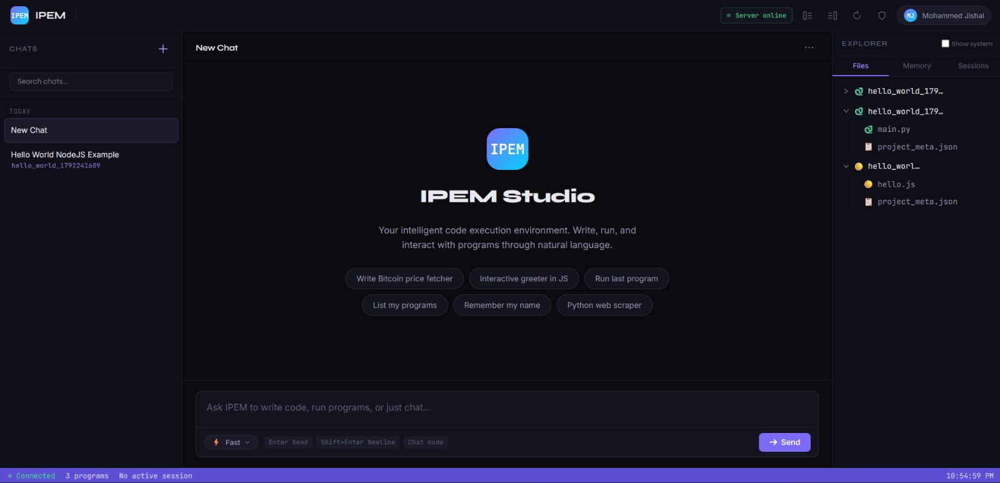
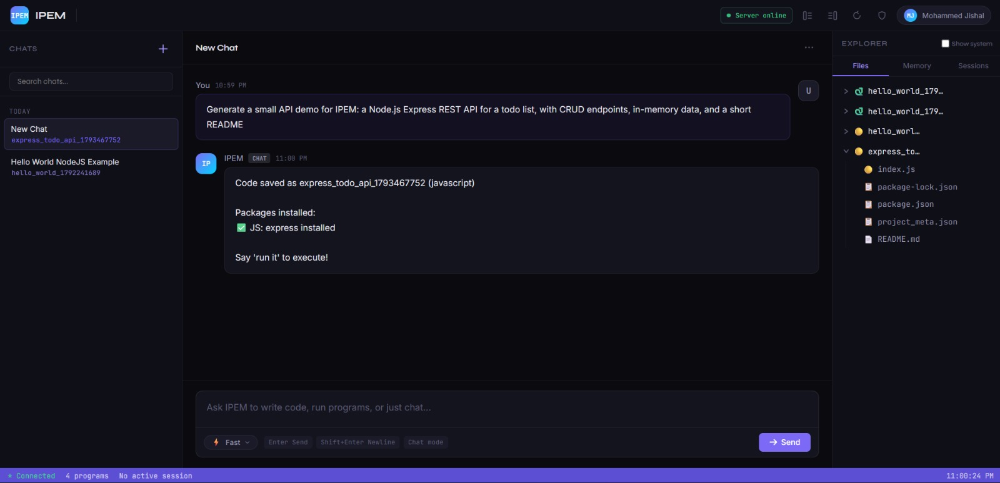
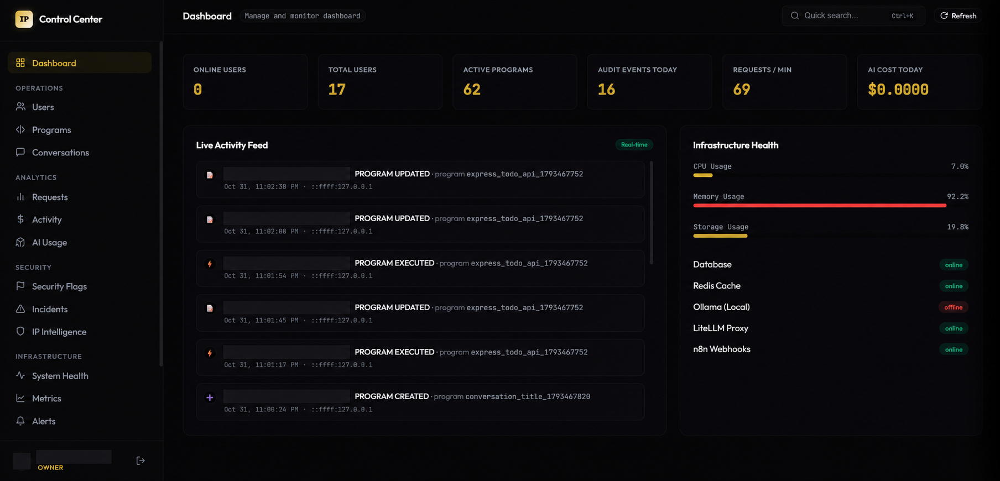

# IPEM

**IPEM** is an AI-assisted coding workspace for creating, editing, running, and managing programs through a conversational interface. It combines a browser-based IDE, execution sessions, project files, conversation memory, and a role-protected administration panel.

[Live application](https://ipem-web.vercel.app) · [Project guide](docs/PROJECT_GUIDE.md)

## Screenshots

### Workspace



### AI-generated code response



### Admin control center (identifiers redacted)



## What you can do

- Describe a program in chat and have IPEM generate or update project files.
- Browse multi-file projects, inspect and edit code in the browser, and save changes.
- Run supported programs, inspect output, provide input to interactive sessions, and stop runs.
- Preview generated web projects and link conversations to their projects.
- Keep conversation history and user-specific memory for continuity.
- Sign up with email verification, sign in with password or configured Google OAuth, and manage your profile.

## Admin control center

The admin panel is available to authorized staff at `frontend/admin.html`. Backend role checks control access to each operation; hiding a UI control does not grant permission.

The control center provides:

- **Dashboard and health:** user/program counts, request volume, audit activity, AI cost summaries, infrastructure status, metrics, and alerts.
- **User administration:** search and inspect users, view their programs and activity, manage roles/statuses, revoke access, add internal notes, and send administrative messages.
- **Program oversight:** inspect programs, review execution information, lock or unlock, change status, delete, and restore where authorized.
- **Conversation moderation:** inspect conversations and messages, change status, lock/unlock, delete, or restore where authorized.
- **Analytics and AI usage:** request and endpoint analytics, user activity, provider/model information, and AI request/cost summaries.
- **Security tools:** review flags and incidents, resolve findings, inspect IP reputation, and manage IP/device blocks.
- **Operations:** inspect service health and use supported service restart controls.

Roles are `owner`, `admin`, `moderator`, and `user`. Account statuses are `active`, `suspended`, `banned`, and `disabled`. Owner and role hierarchy protections are enforced by the API.

## Architecture

```text
Browser (static HTML, CSS, JavaScript)
  ├── User workspace and admin control center
  └── Vercel /api proxy for deployed frontend
          │
          ▼
Express API (backend/, port 9000)
  ├── Authentication, role checks, audit/security and admin APIs
  ├── SQLite metadata and user-scoped filesystem storage
  ├── Program execution and preview sessions
  └── n8n workflow → LiteLLM/model providers (optional integrations)
```

## Repository layout

| Folder | Contents |
|---|---|
| `frontend/` | User, login, signup, profile and admin pages; browser code; Vercel proxy. |
| `backend/` | Express API, authentication, database, project storage, execution and admin services. |
| `workflows/` | Sanitized n8n workflow export. Reconnect credentials and configure service URLs after import. |
| `docs/` | Detailed project guide and README screenshots. |

Runtime databases, logs, generated programs, dependencies, and secret files are excluded from the repository.

## Run locally

Requirements: Node.js and npm. Install any language runtimes you plan to execute. Redis, Docker, n8n, LiteLLM, model-provider credentials, SMTP, and Google OAuth are optional integrations.

1. Copy `backend/.env.example` to `backend/.env` and set a long, unique `JWT_SECRET`. Add credentials only for integrations you enable.
2. Start the API:

   ```sh
   cd backend
   npm install
   npm start
   ```

   The API listens on port `9000` by default. From the repository root, serve the frontend in a second terminal:

   ```sh
   npx http-server frontend -p 3000
   ```

3. Open `http://localhost:3000`. Local frontend requests default to the API at `http://localhost:9000`.

The backend creates an empty SQLite database and user storage folders on first run. Do not copy production databases or user-generated files into the clean repository.

## AI workflow and deployment

- Import `workflows/IPEM_workflow.json` into your n8n instance, reconnect model credentials, and replace `host.docker.internal` URLs with addresses reachable from n8n.
- Configure `N8N_WEBHOOK_URL` and `N8N_HEALTH_URL` for the backend.
- For Vercel, set `frontend/` as the project root and configure `IPEM_UPSTREAM_URL` to the public HTTPS URL of the separately hosted API.
- Set backend `FRONTEND_URL` or `CORS_ALLOWED_ORIGINS` to the deployed frontend origin.
- For Google sign-in, configure the same OAuth client ID in `backend/.env` and `frontend/js/config.js` as `__IPEM_GOOGLE_CLIENT_ID__`.

## Security notes

- Never commit `.env` files, API credentials, live databases, user data, or generated projects.
- Set `JWT_SECRET` before starting the API; the backend exits if it is missing.
- Docker execution is off by default. Review execution isolation before exposing the service to untrusted users.
- Admin capabilities are enforced server-side and require the appropriate account role.

For API routes, data storage, roles, execution modes, configuration, and known limitations, see the [complete project guide](docs/PROJECT_GUIDE.md).
